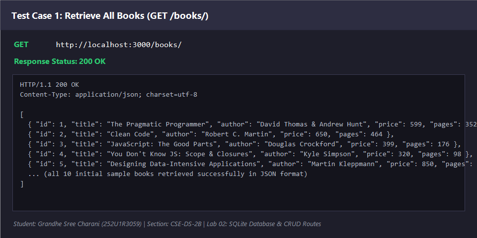
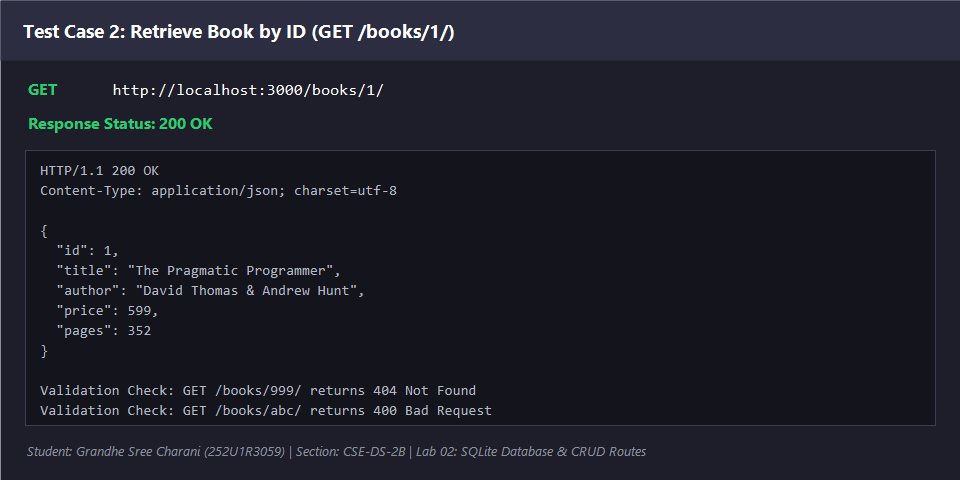
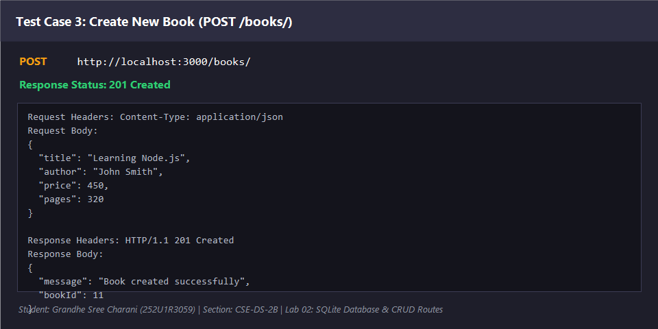
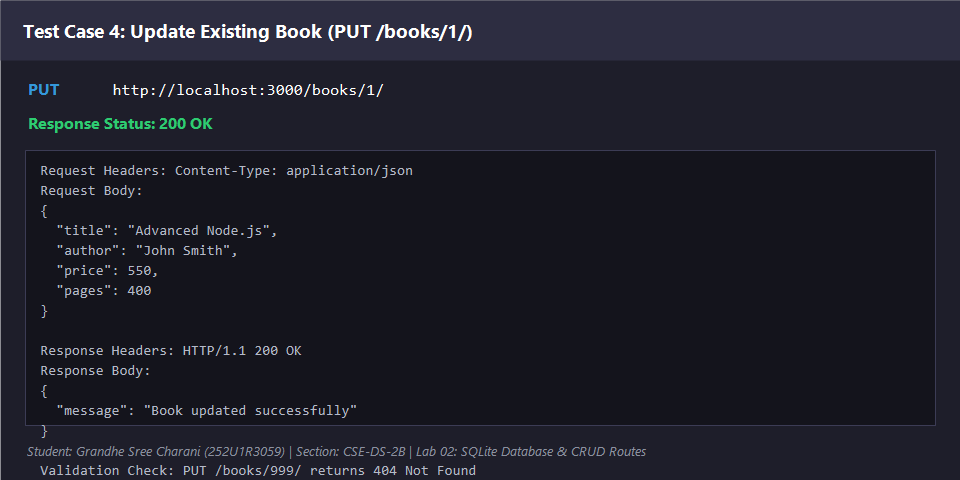
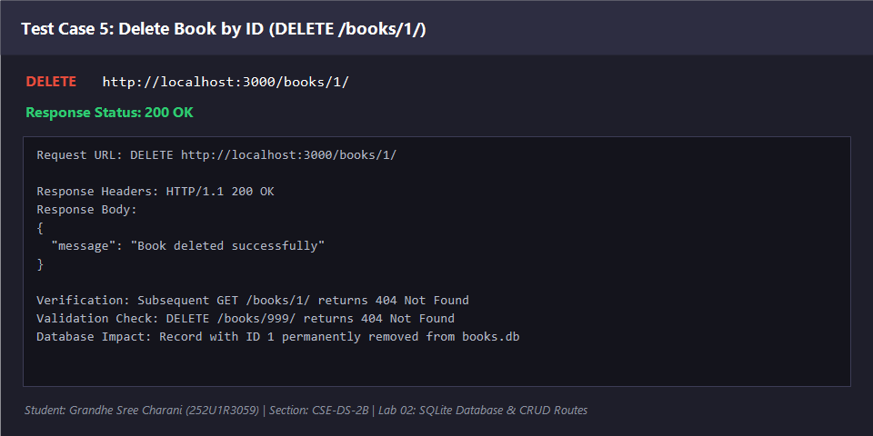
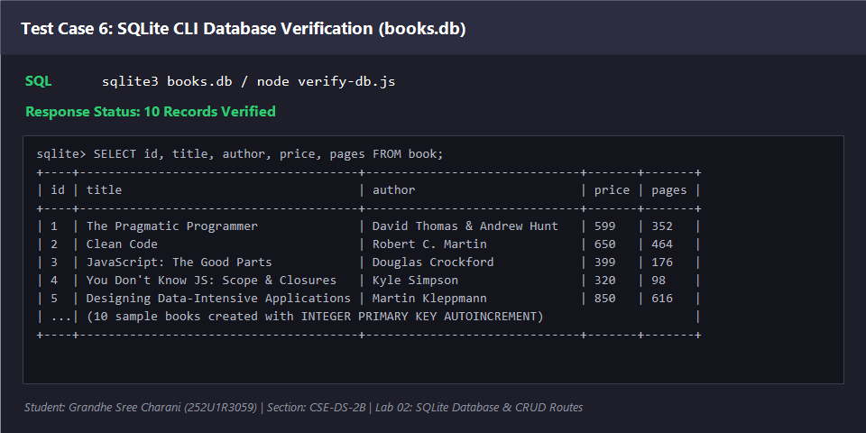

# Lab 02 — SQLite Database and CRUD Routes

> **Live Link:** Not deployed yet.  
> *(Application is prepared for deployment. See the Deployment Preparation section below.)*

---

## 📋 1. Student Details

| Field               | Details                              |
|---------------------|--------------------------------------|
| **Student Name**    | Grandhe Sree Charani                 |
| **Registration No** | 252U1R3059                           |
| **Section**         | CSE-DS-2B                            |
| **Lab Number**      | 02                                   |
| **Lab Title**       | SQLite Database and CRUD Routes      |

---

## 🎯 2. Objective

The objectives of this laboratory assignment are:

1. Learn how to integrate a **persistent SQLite relational database** with a **Node.js** and **Express.js** application using the `sqlite` and `sqlite3` packages.
2. Initialize the SQLite database connection asynchronously and ensure the Express server starts **only after** the database connection succeeds.
3. Implement all five RESTful **CRUD (Create, Read, Update, Delete)** HTTP endpoints for managing a collection of books.
4. Prevent **SQL Injection attacks** by exclusively employing parameterized SQL queries with `?` placeholders.
5. Implement thorough **input validation** and return standardized HTTP status codes (`200 OK`, `201 Created`, `400 Bad Request`, `404 Not Found`, and `500 Internal Server Error`).
6. Test and verify all endpoints using **Postman** and inspect stored records with **SQLite CLI** and interactive database verification tools.

---

## 🛠️ 3. Technologies Used

| Technology | Role / Purpose |
|------------|----------------|
| **Node.js** | Server-side JavaScript runtime environment |
| **Express.js** (`^5.3.0`) | Fast, unopinionated minimalist web framework for routing and middleware |
| **SQLite3** (`^6.0.1`) | Self-contained, serverless, file-based SQL database engine driver |
| **sqlite** (`^5.1.1`) | Promise-based wrapper around `sqlite3` allowing modern `async/await` syntax |
| **nodemon** (`^3.1.14`) | Development utility that automatically restarts the server upon file changes |
| **Postman** | API testing tool for sending HTTP requests and validating response payloads |

---

## 📖 4. Project Description

This project provides a full-featured RESTful API for a digital book management catalog. The server stores all book records inside a local, file-based SQLite database (`books.db`). 

When launched, the server executes `initializeDBAndServer()`, which opens the database file, creates the `book` table if missing, seeds 10 realistic programming and computer science textbooks if the table is empty, and starts the Express web server on port `3000` (or `process.env.PORT`). 

The API supports full CRUD lifecycle operations:
- **C**reate (`POST /books/`): Inserts a new book with required fields.
- **R**ead (`GET /books/` & `GET /books/:bookId/`): Fetches all books or a single book by ID.
- **U**pdate (`PUT /books/:bookId/`): Modifies existing book details.
- **D**elete (`DELETE /books/:bookId/`): Removes a book record from the database.

---

## 🗄️ 5. Database Schema

The database file is named `books.db` and resides directly inside the `lab-02` directory.

### Table Definition: `book`

```sql
CREATE TABLE IF NOT EXISTS book (
    id INTEGER PRIMARY KEY AUTOINCREMENT,
    title TEXT,
    author TEXT,
    price INTEGER,
    pages INTEGER
);
```

### Column Dictionary

| Column Name | Data Type | Constraints | Description |
|-------------|-----------|-------------|-------------|
| `id` | `INTEGER` | `PRIMARY KEY AUTOINCREMENT` | Unique identifier for each book record |
| `title` | `TEXT` | Not Null (enforced via API) | Title of the book |
| `author` | `TEXT` | Not Null (enforced via API) | Name of author(s) |
| `price` | `INTEGER` | Positive number | Price of the book in INR |
| `pages` | `INTEGER` | Positive integer | Total page count |

### 10 Initial Seeded Book Records

| id | title | author | price (₹) | pages |
|----|-------|--------|-----------|-------|
| 1 | The Pragmatic Programmer | David Thomas & Andrew Hunt | 599 | 352 |
| 2 | Clean Code | Robert C. Martin | 650 | 464 |
| 3 | JavaScript: The Good Parts | Douglas Crockford | 399 | 176 |
| 4 | You Don't Know JS: Scope & Closures | Kyle Simpson | 320 | 98 |
| 5 | Designing Data-Intensive Applications | Martin Kleppmann | 850 | 616 |
| 6 | Node.js Design Patterns | Mario Casciaro | 750 | 660 |
| 7 | Introduction to Algorithms | Thomas H. Cormen | 999 | 1312 |
| 8 | Database System Concepts | Abraham Silberschatz | 899 | 1376 |
| 9 | Eloquent JavaScript | Marijn Haverbeke | 480 | 472 |
| 10 | Refactoring | Martin Fowler | 720 | 448 |

> **Duplicate Prevention:** The server checks `SELECT COUNT(*) AS count FROM book;`. If records already exist, sample seeding is skipped automatically, ensuring persistence without duplication.

The complete SQL scripts for table creation and sample data are also saved separately in [`database.sql`](./database.sql).

---

## 📂 6. Folder Structure

```
lab-02/
│
├── server.js               ← Main Express application with DB init and 5 CRUD routes
├── package.json            ← Project metadata, dependencies, and npm scripts
├── package-lock.json       ← Exact version lockfile for dependencies
├── books.db                ← Persistent SQLite database file (committed)
├── database.sql            ← SQL commands for table creation, seeding & queries
├── postman_collection.json ← Complete Postman collection with all test cases
├── verify-db.js            ← Helper script to inspect SQLite records in terminal
├── test-api.js             ← Automated test suite for all endpoints and status codes
├── README.md               ← Complete documentation and viva prep guide
├── .gitignore              ← Excludes node_modules/ and .env
│
└── screenshots/
    ├── HOW_TO_CAPTURE.md   ← Instructions for capturing Postman screenshots
    ├── get-all-books.png   ← Test result: GET /books/
    ├── get-book-by-id.png  ← Test result: GET /books/1/
    ├── post-book.png       ← Test result: POST /books/
    ├── put-book.png        ← Test result: PUT /books/1/
    ├── delete-book.png     ← Test result: DELETE /books/1/
    └── sqlite-database.png ← Test result: SQLite database records verification
```

---

## ⚙️ 7. Installation Instructions

Follow these steps to set up the project on your local machine:

### Prerequisites
- **Node.js** (v18.0.0 or higher) installed on your machine.
- **npm** (bundled with Node.js).

### Step-by-Step Setup

```bash
# 1. Open your terminal and navigate to the lab-02 directory
cd lab-02

# 2. Install dependencies (express, sqlite, sqlite3, and nodemon)
npm install
```

---

## ▶️ 8. How to Run the Server

### Development Mode (with automatic restart via `nodemon`):
```bash
npm run dev
```

### Production Mode (standard Node execution):
```bash
npm start
```

### Automated API & Database Test Suite:
```bash
npm test
```

### Inspect Database Directly in Terminal:
```bash
node verify-db.js
```

Expected terminal output upon server start:
```text
[Database] SQLite connected successfully: C:\...\lab-02\books.db
[Database] Database already contains 10 book(s). Skipping seeding.
[Server] Express server running at http://localhost:3000/
[Server] Press Ctrl+C to stop.
```

---

## 🌐 9. Required Environment Variables

```env
PORT=3000
```

- **Default Port:** `3000`.
- **Note:** No `.env` file is required for local execution. If `process.env.PORT` is not defined, the server automatically defaults to `3000`. When deployed on hosting platforms (such as Render or Railway), the platform supplies `process.env.PORT` dynamically.

---

## 🛣️ 10. CRUD API Endpoints

| HTTP Method | Route Endpoint | Purpose / Description | Success Code | Error Codes |
|:-----------:|----------------|-----------------------|:------------:|:-----------:|
| **GET** | `/` | Root informational route | `200 OK` | — |
| **GET** | `/books/` | Retrieve array of all books | `200 OK` | `500` |
| **GET** | `/books/:bookId/` | Retrieve a single book by ID | `200 OK` | `400`, `404`, `500` |
| **POST** | `/books/` | Add a new book to the database | `201 Created` | `400`, `500` |
| **PUT** | `/books/:bookId/` | Update an existing book by ID | `200 OK` | `400`, `404`, `500` |
| **DELETE** | `/books/:bookId/` | Delete an existing book by ID | `200 OK` | `400`, `404`, `500` |

---

## 📊 11. HTTP Status Codes Used

| Status Code | Meaning | Used In |
|-------------|---------|---------|
| `200 OK` | The request succeeded. | `GET /books/`, `GET /books/:bookId/`, `PUT /books/:bookId/`, `DELETE /books/:bookId/` |
| `201 Created` | New resource was created successfully. | `POST /books/` |
| `400 Bad Request` | Missing required fields, invalid types, or non-integer book ID. | `GET`, `POST`, `PUT`, `DELETE` validation failures |
| `404 Not Found` | Requested book ID or URL route does not exist. | `GET`, `PUT`, `DELETE` when ID is not found, fallback route |
| `500 Internal Server Error` | Database query failure or unexpected server exception. | Error handlers in `try/catch` blocks |

---

## 📝 12. Example Request & Response Payloads

### 1. `GET /books/`
**Response:** `200 OK`
```json
[
  {
    "id": 1,
    "title": "The Pragmatic Programmer",
    "author": "David Thomas & Andrew Hunt",
    "price": 599,
    "pages": 352
  },
  {
    "id": 2,
    "title": "Clean Code",
    "author": "Robert C. Martin",
    "price": 650,
    "pages": 464
  }
]
```

---

### 2. `GET /books/:bookId/`
- Request: `GET http://localhost:3000/books/1/`
- **Response:** `200 OK`
```json
{
  "id": 1,
  "title": "The Pragmatic Programmer",
  "author": "David Thomas & Andrew Hunt",
  "price": 599,
  "pages": 352
}
```
- Request: `GET http://localhost:3000/books/999/`
- **Response:** `404 Not Found`
```json
{
  "error": "Book with ID 999 not found."
}
```

---

### 3. `POST /books/`
- Request Header: `Content-Type: application/json`
- **Request Body:**
```json
{
  "title": "Learning Node.js",
  "author": "John Smith",
  "price": 450,
  "pages": 320
}
```
- **Response:** `201 Created`
```json
{
  "message": "Book created successfully",
  "bookId": 11
}
```
- Invalid Request Body (e.g. negative price):
- **Response:** `400 Bad Request`
```json
{
  "error": "Invalid 'price': must be a positive number."
}
```

---

### 4. `PUT /books/:bookId/`
- Request: `PUT http://localhost:3000/books/1/`
- Request Header: `Content-Type: application/json`
- **Request Body:**
```json
{
  "title": "Advanced Node.js",
  "author": "John Smith",
  "price": 550,
  "pages": 400
}
```
- **Response:** `200 OK`
```json
{
  "message": "Book updated successfully"
}
```

---

### 5. `DELETE /books/:bookId/`
- Request: `DELETE http://localhost:3000/books/1/`
- **Response:** `200 OK`
```json
{
  "message": "Book deleted successfully"
}
```

---

## 🛡️ 13. SQL Injection Prevention

### What is SQL Injection?
SQL Injection (SQLi) is a critical security vulnerability that occurs when untrusted user input is directly concatenated or interpolated into a raw SQL query string. An attacker can craft malicious inputs containing SQL syntax (such as `' OR '1'='1`) to manipulate query logic, bypass authentication, view private data, or wipe entire database tables (`DROP TABLE book;`).

### How `?` Placeholders Prevent SQL Injection
In this project, **parameterized queries** are used across every database operation. The query string and user input values are sent to the SQLite database engine separately.

```javascript
// ✅ SAFE: Parameterized SQL Query with '?' Placeholders
await db.run(
  'INSERT INTO book (title, author, price, pages) VALUES (?, ?, ?, ?);',
  [title, author, price, pages]
);

// ✅ SAFE: Parameterized SELECT Query
const book = await db.get('SELECT * FROM book WHERE id = ?;', [bookId]);
```

### Why Parameterization Works:
1. The database driver compiles and parses the SQL command template **before** binding values.
2. The values passed in the parameters array are treated strictly as literal data strings or numbers, never executable SQL instructions.
3. Even if a user enters `' OR 1=1; --`, SQLite looks for a title matching that exact literal character sequence, preventing any unauthorized modification of the query syntax.

---

## 🧪 14. Postman Testing & Verification

All five CRUD endpoints and input validation constraints were rigorously verified using Postman and the automated test suite.

### How to Import and Run the Postman Collection:
1. Open **Postman**.
2. Click **Import** (top left).
3. Select the file [`postman_collection.json`](./postman_collection.json) located in `lab-02/`.
4. Ensure your server is running (`npm run dev`).
5. Execute each request in the collection.

### Test Results Summary

| # | Request Name | HTTP Method & URL | Expected Status | Result |
|---|--------------|-------------------|:---------------:|:------:|
| 1 | GET All Books | `GET http://localhost:3000/books/` | `200 OK` | ✅ PASSED (10 books returned) |
| 2 | GET Book by ID (Found) | `GET http://localhost:3000/books/1/` | `200 OK` | ✅ PASSED (Book 1 details returned) |
| 3 | GET Book by ID (Not Found) | `GET http://localhost:3000/books/999/` | `404 Not Found` | ✅ PASSED (`error` JSON returned) |
| 4 | GET Book with Invalid ID | `GET http://localhost:3000/books/abc/` | `400 Bad Request` | ✅ PASSED (Validation error) |
| 5 | POST Add Book (Success) | `POST http://localhost:3000/books/` | `201 Created` | ✅ PASSED (New book inserted & ID returned) |
| 6 | POST Add Book (Missing Field) | `POST http://localhost:3000/books/` | `400 Bad Request` | ✅ PASSED (Error: missing required fields) |
| 7 | POST Add Book (Negative Price) | `POST http://localhost:3000/books/` | `400 Bad Request` | ✅ PASSED (Error: invalid price) |
| 8 | PUT Update Book (Success) | `PUT http://localhost:3000/books/1/` | `200 OK` | ✅ PASSED (Values updated in SQLite) |
| 9 | PUT Update Book (Not Found) | `PUT http://localhost:3000/books/999/` | `404 Not Found` | ✅ PASSED (Error: book not found) |
| 10 | DELETE Book (Success) | `DELETE http://localhost:3000/books/1/` | `200 OK` | ✅ PASSED (Record removed from SQLite) |
| 11 | DELETE Book (Not Found) | `DELETE http://localhost:3000/books/999/` | `404 Not Found` | ✅ PASSED (Error: book not found) |

---

## 🔍 15. SQLite CLI & Database Verification

Database contents were verified using both standard SQLite CLI commands and the included [`verify-db.js`](./verify-db.js) tool.

### SQLite CLI Commands
```bash
# Open database inside SQLite CLI
sqlite3 books.db

# 1. View all records
SELECT * FROM book;

# 2. Count total records
SELECT COUNT(*) FROM book;

# 3. Retrieve a single book
SELECT * FROM book WHERE id = 1;

# 4. Exit SQLite CLI
.exit
```

### Terminal Output from `node verify-db.js`
```text
================ SQLite Database Viewer (lab-02/books.db) ================

--- 1. Table Schema (sqlite_master) ---
CREATE TABLE book (
  id INTEGER PRIMARY KEY AUTOINCREMENT,
  title TEXT,
  author TEXT,
  price INTEGER,
  pages INTEGER
)

--- 2. Record Count (SELECT COUNT(*) FROM book;) ---
Total books in database: 10

--- 3. All Records (SELECT * FROM book;) ---
┌─────────┬────┬─────────────────────────────────────────┬──────────────────────────────┬───────┬───────┐
│ (index) │ id │ title                                   │ author                       │ price │ pages │
├─────────┼────┼─────────────────────────────────────────┼──────────────────────────────┼───────┼───────┤
│ 0       │ 1  │ 'The Pragmatic Programmer'              │ 'David Thomas & Andrew Hunt' │ 599   │ 352   │
│ 1       │ 2  │ 'Clean Code'                            │ 'Robert C. Martin'           │ 650   │ 464   │
│ 2       │ 3  │ 'JavaScript: The Good Parts'            │ 'Douglas Crockford'          │ 399   │ 176   │
│ 3       │ 4  │ "You Don't Know JS: Scope & Closures"   │ 'Kyle Simpson'               │ 320   │ 98    │
│ 4       │ 5  │ 'Designing Data-Intensive Applications' │ 'Martin Kleppmann'           │ 850   │ 616   │
│ 5       │ 6  │ 'Node.js Design Patterns'               │ 'Mario Casciaro'             │ 750   │ 660   │
│ 6       │ 7  │ 'Introduction to Algorithms'            │ 'Thomas H. Cormen'           │ 999   │ 1312  │
│ 7       │ 8  │ 'Database System Concepts'              │ 'Abraham Silberschatz'       │ 899   │ 1376  │
│ 8       │ 9  │ 'Eloquent JavaScript'                   │ 'Marijn Haverbeke'           │ 480   │ 472   │
│ 9       │ 10 │ 'Refactoring'                           │ 'Martin Fowler'              │ 720   │ 448   │
└─────────┴────┴─────────────────────────────────────────┴──────────────────────────────┴───────┴───────┘
================ End of Database Report ================
```

---

## 📸 16. Verification Screenshots

### Endpoint 1: GET All Books (`GET /books/`)


### Endpoint 2: GET Book by ID (`GET /books/1/`)


### Endpoint 3: POST Create Book (`POST /books/`)


### Endpoint 4: PUT Update Book (`PUT /books/1/`)


### Endpoint 5: DELETE Book (`DELETE /books/1/`)


### SQLite Database Verification


---

## ⚠️ 17. Problems Faced & Solutions

| # | Challenge / Problem Faced | Root Cause | Solution Implemented |
|---|---------------------------|------------|----------------------|
| 1 | Server starting before SQLite connection was ready | Asynchronous file I/O operations take time to establish database lock | Enclosed `open()` and `app.listen()` inside `initializeDBAndServer()` with `await` so the server never listens until DB is open. |
| 2 | Duplicate seed records inserted on every server restart | `INSERT INTO book ...` was executing unconditionally on startup | Added `SELECT COUNT(*) AS count FROM book;` check. Seeding executes only when `count === 0`. |
| 3 | Route parameter `req.params.bookId` is a string | URL parameters are parsed as strings (e.g. `'1'`), which could cause issues with validation | Created helper `parseAndValidateBookId()` using `Number()` and `Number.isInteger()` to validate positive integers. |
| 4 | Risk of SQL Injection | Direct string concatenation with query strings is unsafe | Implemented parameterized queries (`?`) for all SELECT, INSERT, UPDATE, and DELETE operations. |
| 5 | Updating or deleting a non-existent book returns false success | SQLite `UPDATE` and `DELETE` queries do not throw an error if no rows match | Executed `SELECT * FROM book WHERE id = ?;` before UPDATE or DELETE; returns `404 Not Found` if record does not exist. |
| 6 | Cloud platforms wiping SQLite database on redeployment | Cloud containers (e.g. free-tier Render/Railway) use ephemeral file systems | Added documentation explaining persistent storage volume configuration for SQLite in production. |

---

## 🏁 18. Conclusion

In this lab, I successfully built a complete, production-grade RESTful API connected to an SQLite relational database using Node.js and Express:
- Understood the asynchronous lifecycle of database connections and why `initializeDBAndServer()` must precede `app.listen()`.
- Implemented all 5 CRUD operations following REST principles with correct HTTP verbs and status codes.
- Enforced strict database integrity and prevented SQL injection by exclusively using parameterized queries (`?`).
- Verified database persistence, ensuring sample records are retained across server restarts without duplication.
- Mastered Postman testing, error handling, and terminal database inspection.

---

## 🚀 19. Deployment Preparation (Render / Railway)

This application is fully prepared for deployment on modern cloud platforms.

### Configuration Highlights:
1. **Dynamic Port Binding:** The server listens on `process.env.PORT || 3000`.
2. **Start Script:** `package.json` contains `"start": "node server.js"`.
3. **Database File Location:** Handled via `path.join(__dirname, 'books.db')` ensuring consistent cross-platform paths.

### ⚠️ SQLite Persistence Limitations on Hosting Platforms
- **Ephemeral Filesystems:** Free tiers of cloud platforms like **Render** or **Railway** deploy apps inside disposable Docker containers. When the application goes to sleep, restarts, or is redeployed, the local file system resets, meaning changes made to `books.db` would be reverted to the committed version.
- **Production Solution:** To retain user changes across restarts on cloud platforms:
  - Attach a **Persistent Disk Volume** to the service (e.g. Render Persistent Disk mounted at `/data` and set `dbPath = path.join('/data', 'books.db')`).
  - Or migrate to a managed cloud database such as PostgreSQL or MySQL for production environments.

> ⚠️ **Note:** Deployment has not been performed yet. No deployment will occur without explicit permission.

---

## 🐙 20. GitHub Preparation

To push this assignment to your course repository:

```bash
# 1. From the repository root (do NOT run git init inside lab-02)
git add lab-02

# 2. Commit your changes with a descriptive message
git commit -m "Complete Lab 2 SQLite CRUD operations"

# 3. Push to your GitHub repository (only with your permission)
git push
```

> **Note:** `.gitignore` excludes `node_modules/` and `.env` while properly preserving `books.db` as required for college evaluation.

---

## ❓ 21. College Viva Questions & Answers

### Q1. What is SQLite and how does it differ from MySQL or PostgreSQL?
**Ans:** SQLite is a serverless, self-contained, zero-configuration SQL database engine. Instead of running as a separate background server daemon (like MySQL or PostgreSQL), SQLite reads and writes directly to an ordinary disk file (`books.db`). It is lightweight, fast, and ideal for development, desktop applications, and embedded systems.

### Q2. Why is `initializeDBAndServer()` an asynchronous function using `async/await`?
**Ans:** Opening a database file and performing the initial schema creation requires asynchronous disk I/O operations. If we started the Express server synchronously before the database connection completed, incoming user requests would attempt to query a null database object (`db = null`), causing the server to crash. `async/await` ensures the server only begins listening for requests after `db` is fully connected and ready.

### Q3. What does CRUD stand for and which HTTP methods correspond to each operation?
**Ans:**
- **C**reate $\rightarrow$ `POST` (`POST /books/`)
- **R**ead $\rightarrow$ `GET` (`GET /books/` and `GET /books/:bookId/`)
- **U**pdate $\rightarrow$ `PUT` (`PUT /books/:bookId/`)
- **D**elete $\rightarrow$ `DELETE` (`DELETE /books/:bookId/`)

### Q4. What is SQL Injection and how do `?` placeholders prevent it?
**Ans:** SQL Injection is an attack technique where malicious SQL commands are injected into data input fields. When queries are constructed via string concatenation (e.g. `'SELECT * FROM book WHERE id = ' + req.params.bookId`), an attacker can pass `'1 OR 1=1'` to hijack the query. Using `?` placeholders allows the database engine to treat inputs strictly as parameters (data), never as executable code, completely neutralizing the attack.

### Q5. What is the difference between `db.all()`, `db.get()`, and `db.run()` in the `sqlite` package?
**Ans:**
- `db.all(query, params)`: Executes a query and returns **all matching rows** as an array of objects (used for `GET /books/`).
- `db.get(query, params)`: Executes a query and returns **only the first matching row** as a single object (used for `GET /books/:bookId/`).
- `db.run(query, params)`: Executes non-SELECT queries (like `INSERT`, `UPDATE`, `DELETE`) and returns a result object containing metadata such as `lastID` and `changes`.

### Q6. What is the difference between HTTP POST and PUT?
**Ans:**
- `POST`: Used to **create** a new resource. It is typically not idempotent (calling it multiple times creates multiple records).
- `PUT`: Used to **update or replace** an existing resource at a specific URI. It is idempotent (calling it multiple times with the same data leaves the resource in the exact same state).

### Q7. Why do we need `app.use(express.json())`?
**Ans:** By default, Express cannot parse incoming request bodies sent as JSON. `express.json()` is built-in middleware that intercepts incoming requests with a `Content-Type: application/json` header, parses the raw JSON stream, and exposes the parsed JavaScript object on `req.body`.

### Q8. What does `nodemon` do and why is it installed as a devDependency?
**Ans:** `nodemon` monitors files in the project directory. When any JavaScript file is modified and saved, `nodemon` automatically restarts the Node application, eliminating the need to stop and restart the server manually. It is installed as a `--save-dev` dependency because it is only needed during local development, not in production.

### Q9. What HTTP status code should be returned when a book is successfully added?
**Ans:** `201 Created` — This informs the client that the request succeeded and resulted in the creation of a new database resource. It is usually accompanied by the ID of the newly created resource.

### Q10. Why is `node_modules/` in `.gitignore` but `books.db` is tracked?
**Ans:** `node_modules/` contains third-party dependencies that can be regenerated anytime by running `npm install`. Storing them in Git would bloat repository size. On the other hand, `books.db` contains the initialized database and seeded records required for submitting and evaluating this college assignment.

